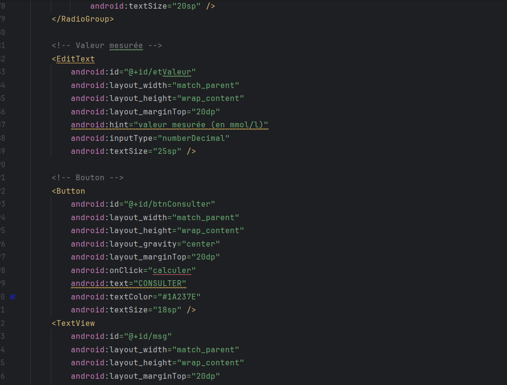
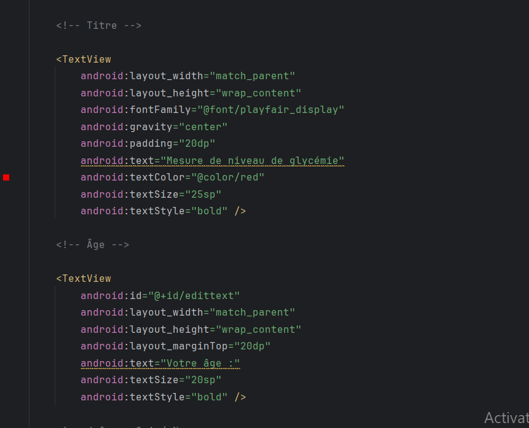
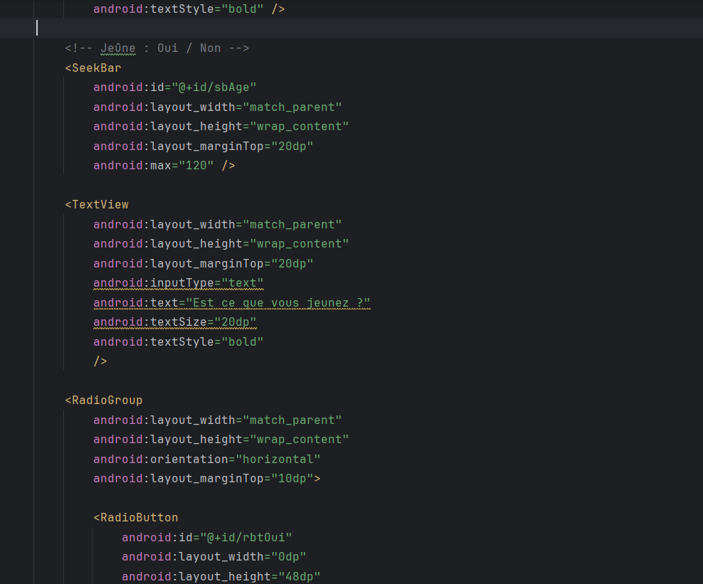
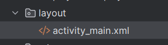
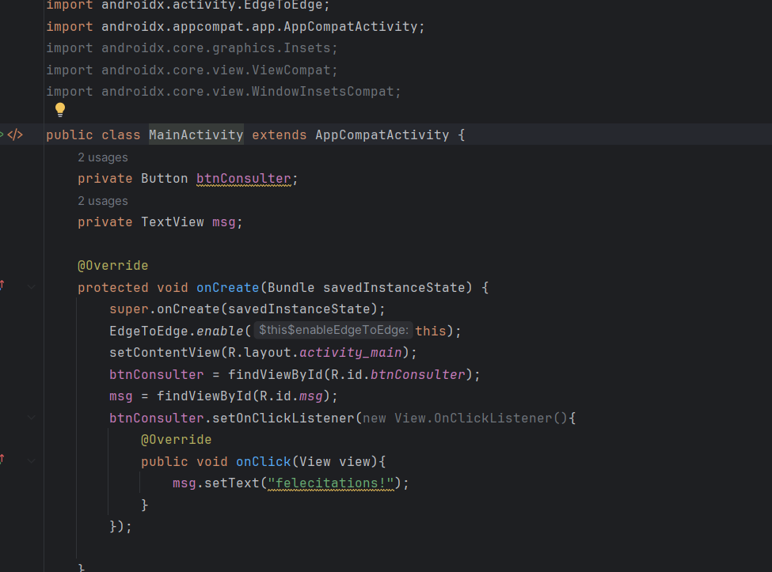

# Mesure de niveau de glycémie

Application Android réalisée avec Java dans le cadre du projet LSI3. Son interface permet de saisir des informations liées à une mesure de glycémie.

> **Prototype pédagogique :** l’application ne calcule ni n’interprète actuellement les résultats. Le bouton **CONSULTER** affiche uniquement un message de confirmation. Cette application ne doit pas être utilisée pour prendre une décision médicale.

## Fonctionnalités de l’interface

- Sélection de l’âge à l’aide d’un curseur (de 0 à 120).
- Choix du statut de jeûne : oui ou non.
- Saisie d’une valeur mesurée en mmol/L.
- Affichage d’un message lorsque l’utilisateur appuie sur **CONSULTER**.

## Captures d’écran

### Interface de l’application

### Code de l’interface

Les captures suivantes montrent les différentes parties du fichier de mise en page Android.

### Code Java

